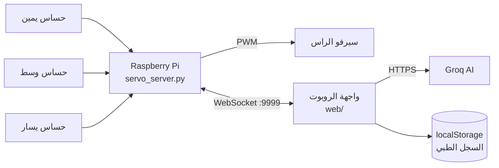

# NABD Robot | روبوت نبض 🤖❤️

**نبض** روبوت للفرز الطبي (Medical Triage) بيستقبل المريض، بيحكي معه بالصوت أو بالكتابة، بيجمع معلوماته وأعراضه ومكان الألم، وبيطلع له ملخص فرز طبي مبدئي بالذكاء الاصطناعي بصيغة PDF.

الروبوت فيه راس مطبوع 3D على سيرفو، وبيلفّ باتجاه الشخص اللي بيقرّب منه بفضل 3 حساسات ألتراسونيك. وأول ما حدا يقرب، شاشة الروبوت بتصحى وبتسأله: «كيف أقدر أساعدك اليوم؟».

ومع المشروع في **استبيان بحثي** عن الأخطاء الطبية ودور الذكاء الاصطناعي في تحسين التشخيص، مع صفحة إحصائيات لنتائجه.

> ⚠️ نبض أداة مساعدة للفرز المبدئي فقط، وما بيغني عن الطبيب ولا بيعطي تشخيص نهائي.

---

## 📁 هيكل المشروع

```
NABD/
├── web/                     واجهة الروبوت (بتشتغل على شاشة الروبوت)
│   ├── index.html           الشاشة الرئيسية + كشف اقتراب الشخص + أوامر صوتية
│   ├── diagnosis.html       الفحص والفرز الطبي بالذكاء الاصطناعي
│   ├── records.html         السجل الطبي (التقارير المحفوظة)
│   ├── set.html             لوحة تحكم السيرفو والحساسات
│   └── config.example.js    نموذج ملف الإعدادات (مفتاح Groq)
├── raspberry-pi/
│   ├── servo_server.py      سيرفر WebSocket: بيقرا الحساسات وبيحرّك السيرفو
│   └── requirements.txt
├── survey/
│   ├── index.html           الاستبيان البحثي
│   └── statistics.html      إحصائيات نتائج الاستبيان (رسوم بيانية)
└── 3d-models/
    ├── head/                راس الروبوت + الأنتينات
    └── enclosure/           الصندوق (القاعدة) والأغطية والكليبسات
```

---

## ⚙️ كيف بيشتغل النظام



1. **الحساسات:** الـ Raspberry Pi بيقرا الحساسات الثلاثة كل 0.15 ثانية تقريباً.
2. **حركة الراس:** في الوضع التلقائي، إذا شخص صار أقرب من حد المسافة (الافتراضي 50 سم)، السيرفو بيلف الراس بشكل ناعم (درجة درجة) باتجاه الحساس اللي كشفه:
   - يمين = 0°
   - وسط = 90°
   - يسار = 180°
3. **إرسال الحالة:** السيرفر بيبعت الحالة (المسافات، زاوية السيرفو، الحساس اللي فعّل الحركة) لكل الشاشات المتصلة عبر WebSocket.
4. **صحوة الشاشة:** صفحة `index.html` بتستقبل الحالة، وإذا لقت شخص قريب بتطلع شاشة الترحيب وبتبلش تسمع للأوامر الصوتية.
5. **الفحص:** صفحة `diagnosis.html` بتاخد المريض خطوة خطوة:
   1. يختار طريقة التواصل: محادثة صوتية مباشرة أو كتابة.
   2. يعرّف عن نفسه: الاسم، العمر، الجنس، والتاريخ المرضي.
   3. يحكي عن أعراضه بمحادثة مع الذكاء الاصطناعي.
   4. يحدد مكان الألم على نموذج جسم ثلاثي الأبعاد (BioDigital Human، ذكر أو أنثى حسب المريض).
   5. يرفق صور طبية إذا عنده.
   6. بيطلع له **ملخص فرز طبي** بينحفظ بالسجل وبينزّل كـ PDF.
6. **السجل:** صفحة `records.html` بتعرض كل التقارير المحفوظة على الجهاز.
7. **لوحة التحكم:** صفحة `set.html` بتتحكم بالسيرفو:
   - وضع تلقائي أو يدوي، وتحريك الزاوية يدوياً.
   - حد المسافة.
   - سرعة الحركة.
   - تشغيل أو إطفاء كل حساس لحاله.

---

## 🔌 الدارة الكهربائية (Circuit)

### القطع

| القطعة | العدد | ملاحظات |
|---|---|---|
| Raspberry Pi (3/4/5) | 1 | العقل الأساسي، بيشغّل `servo_server.py` |
| حساس ألتراسونيك HC-SR04 | 3 | يمين، وسط، يسار. المدى من 2 لـ 400 سم |
| سيرفو موتور (SG90 / MG996R) | 1 | بيلف راس الروبوت من 0° لـ 180° |
| مقاومة 1kΩ | 3 | لمقسّم الجهد على خط ECHO |
| مقاومة 2kΩ | 3 | لمقسّم الجهد على خط ECHO |
| مصدر 5V خارجي | 1 | لتغذية السيرفو (يفضّل 2A أو أكثر) |
| شاشة | 1 | لعرض واجهة الروبوت `web/` |

### التوصيلات (ترقيم BCM)

| القطعة | الطرف | Raspberry Pi GPIO (BCM) | رقم البن الفيزيائي |
|---|---|---|---|
| **السيرفو** | Signal (برتقالي/أصفر) | **GPIO 13** (PWM1) | Pin 33 |
| | VCC (أحمر) | 5V خارجي | — |
| | GND (بني/أسود) | GND مشترك | Pin 34 |
| **حساس الوسط** (Center، 90°) | TRIG | **GPIO 4** | Pin 7 |
| | ECHO | **GPIO 17** (عبر مقسّم جهد) | Pin 11 |
| **حساس اليمين** (Right، 0°) | TRIG | **GPIO 5** | Pin 29 |
| | ECHO | **GPIO 27** (عبر مقسّم جهد) | Pin 13 |
| **حساس اليسار** (Left، 180°) | TRIG | **GPIO 18** | Pin 12 |
| | ECHO | **GPIO 25** (عبر مقسّم جهد) | Pin 22 |
| **كل الحساسات** | VCC | 5V | Pin 2 / 4 |
| | GND | GND | Pin 6 / 9 / 14 |

### مقسّم الجهد على ECHO ⚠️

خرج ECHO بالـ HC-SR04 جهده **5V**، بس بنات الـ Raspberry Pi بتتحمل **3.3V** بس. عشان هيك لازم مقسّم جهد على كل خط ECHO:

```
HC-SR04 ECHO ──[ 1kΩ ]──┬──► GPIO (ECHO)
                         │
                       [ 2kΩ ]
                         │
                        GND
```

الجهد عند الـ GPIO = 5V × 2k / (1k + 2k) ≈ **3.3V** ✅

### مخطط الدارة

```
                    ┌──────────────────────────────┐
                    │        Raspberry Pi          │
                    │                              │
  Center HC-SR04    │ GPIO4  (Pin 7)  ◄── TRIG     │
  TRIG/ECHO ────────┤ GPIO17 (Pin 11) ◄── ECHO*    │
                    │                              │
  Right HC-SR04     │ GPIO5  (Pin 29) ◄── TRIG     │
  TRIG/ECHO ────────┤ GPIO27 (Pin 13) ◄── ECHO*    │
                    │                              │
  Left HC-SR04      │ GPIO18 (Pin 12) ◄── TRIG     │
  TRIG/ECHO ────────┤ GPIO25 (Pin 22) ◄── ECHO*    │
                    │                              │
  Servo Signal ─────┤ GPIO13 (Pin 33)  PWM 50Hz    │
                    │                              │
                    │ 5V (Pin 2/4) ──► VCC حساسات  │
                    │ GND ───────────┬─► GND الكل  │
                    └────────────────┼─────────────┘
                                     │
  5V خارجي (+) ──► Servo VCC         │
  5V خارجي (−) ──────────────────────┘  (أرضي مشترك)

  * كل ECHO بيمر على مقسّم جهد 1kΩ / 2kΩ
```

### ملاحظات على الدارة

- **تغذية السيرفو:** السيرفو بيسحب تيار عالي وهو بيتحرك، فالأفضل تغذيه من مصدر 5V خارجي مش من بن الـ 5V على الـ Pi، وتوصل **أرضي المصدر مع أرضي الـ Pi** (GND مشترك)، وإلا الإشارة ما بتشتغل صح.
- **إشارة PWM:** التردد 50Hz، و`duty = 2 + angle / 18`، يعني 2% عند 0° و12% عند 180°.
- **حساب المسافة:** المسافة = زمن نبضة ECHO × 17150 (نص سرعة الصوت بالسم/ثانية). أي قراءة أقل من 2 سم أو أكثر من 400 سم بتنهمل.

---

## 🖨️ الموديلات ثلاثية الأبعاد

| الملف | الوصف |
|---|---|
| `3d-models/head/head_v1.stl` | راس الروبوت (النسخة الأولى) |
| `3d-models/head/head_v2.stl` | راس الروبوت (النسخة الثانية) |
| `3d-models/head/antenna_1.stl`, `antenna_2.stl` | أنتينات الراس |
| `3d-models/enclosure/box_1…4.stl` | جوانب صندوق القاعدة |
| `3d-models/enclosure/top_1…4.stl`, `top_plate.stl` | الغطاء العلوي |
| `3d-models/enclosure/clips.stl`, `circle_clips.stl` | كليبسات التثبيت |
| `3d-models/enclosure/box_1.3mf` | ملف مشروع الطباعة (Bambu / Prusa Slicer) |

---

## 🚀 التشغيل

### 1. سيرفر الـ Raspberry Pi

```bash
cd raspberry-pi
pip install -r requirements.txt
python3 servo_server.py
```

السيرفر بيشتغل على `ws://0.0.0.0:9999`. وإذا شغّلته على كمبيوتر عادي (من غير مكتبة RPi.GPIO)، بيشتغل بـ **وضع المحاكاة** وبيطلع مسافات عشوائية، فبتقدر تجرب الواجهة من غير قطع.

### 2. واجهة الروبوت

1. انسخ ملف الإعدادات وحط مفتاح Groq تبعك (بتاخده مجاناً من [console.groq.com/keys](https://console.groq.com/keys)):
   ```bash
   cp web/config.example.js web/config.js
   ```
2. عدّل عنوان الـ Raspberry Pi في `web/index.html`:
   ```js
   const WS_URL = 'ws://<IP-الراسبيري>:9999';
   ```
3. افتح `web/index.html` بمتصفح Chrome أو Edge. الأوامر الصوتية بتحتاج Web Speech API.

> 💡 الأفضل تشغّل الواجهة عبر سيرفر محلي عشان المايكروفون يشتغل:
> `python -m http.server 8000` جوا مجلد `web`، بعدين افتح `http://localhost:8000`.

### 3. الاستبيان

افتح `survey/index.html`، والإجابات بتنحفظ في جدول `survey_responses` على Supabase. صفحة `survey/statistics.html` بتعرض النتائج برسوم بيانية.

---

## 🧰 التقنيات المستخدمة

- **Hardware:**
  - Raspberry Pi
  - 3 حساسات HC-SR04
  - سيرفو موتور
  - قطع مطبوعة 3D
- **Backend:** Python مع `asyncio` و`websockets` و`RPi.GPIO`
- **Frontend:** HTML و CSS و JavaScript بدون frameworks، وبتدعم العربي (RTL، خط Tajawal)
- **الذكاء الاصطناعي:** Groq API. الموديل الأساسي `openai/gpt-oss-120b`، والاحتياطي `gpt-oss-20b` بعده `llama-3.3-70b-versatile`.
- **الصوت:** Web Speech API، للتعرّف على الكلام والنطق.
- **التشريح:** BioDigital Human، نماذج 3D للأجهزة الجسمية.
- **التقارير:** jsPDF
- **الاستبيان:** Supabase و Chart.js
